# pfsense-soc-threat-investigation
SOC investigation of TCP traffic, firewall logs, and defensive controls using pfSense and Wireshark

# pfSense Network Threat Detection & SOC Investigation

## Project Overview

This project demonstrates a Security Operations Center (SOC) investigation workflow using pfSense, Kali Linux, Ubuntu Server, and Wireshark in an isolated VirtualBox environment.

The objective was to establish normal network traffic, investigate blocked TCP connection attempts, analyze retransmissions, correlate packet captures with firewall logs, and validate defensive security controls.

All traffic was generated through authorized homelab testing.

### Skills Demonstrated

- Network security monitoring
- Firewall rule configuration and analysis
- Wireshark packet inspection
- TCP SYN and retransmission analysis
- Firewall log correlation
- Network troubleshooting
- Security investigation documentation
- Defensive control validation

## 1. Lab Environment

| Component | Configuration |
|---|---|
| Hypervisor | Oracle VirtualBox |
| Firewall | pfSense 2.9.0 |
| Kali Linux | 192.168.60.100/24 |
| Ubuntu Server | 192.168.50.100/24 |
| pfSense LAN | 192.168.50.1/24 |
| pfSense OPT1 | 192.168.60.1/24 |
| Kali Network | TestNet |
| Ubuntu Network | SecurityLab |
| Web Server | Nginx, TCP port 80 |
| Analysis Tools | Wireshark, curl, pfSense firewall logs |

### Network Traffic Flow

Kali Linux (192.168.60.100)

↓

pfSense OPT1 (192.168.60.1)

↓

pfSense LAN (192.168.50.1)

↓

Ubuntu Server (192.168.50.100)

Traffic between the two subnets passes through pfSense for firewall inspection.

---

## 2. Phase 1 — Network and Firewall Verification

### 2.1 Persistent Routing Configuration

Configured Kali Linux with a persistent static route to the Ubuntu subnet through pfSense OPT1.

Verified that traffic destined for 192.168.50.100 was routed through 192.168.60.1 using eth1.

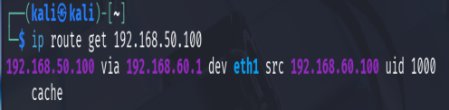

### 2.2 OPT1 Firewall Rules

Configured narrowly scoped firewall permissions for authorized testing:

- Allow TCP port 80 from Kali to Ubuntu
- Allow ICMP Echo Request from Kali to Ubuntu

All other unmatched inbound traffic remained subject to the default deny policy.

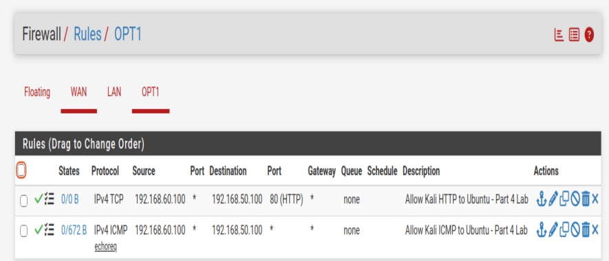

### 2.3 HTTP Connectivity Verification

Used curl to confirm that Kali could access the Nginx web server on Ubuntu.

The server returned HTTP 200 OK.

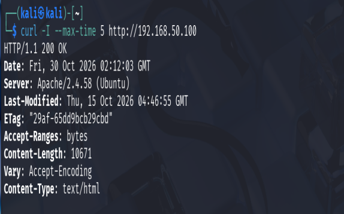

### 2.4 pfSense Interface Verification

Verified the configured WAN, LAN, and OPT1 interfaces.

**WAN Interface**

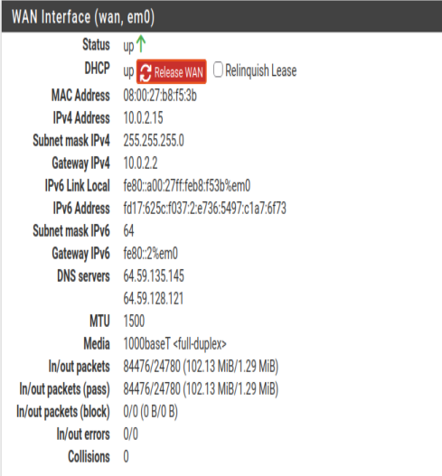

**LAN Interface**

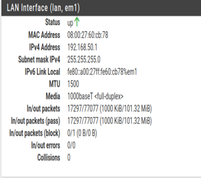

**OPT1 Interface**

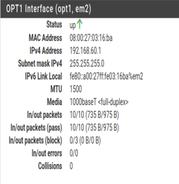

---

## 3. Phase 2 — Establish Normal Traffic Baseline

Before investigating blocked traffic, normal network behavior was captured for comparison.

### 3.1 ICMP Traffic Analysis

Generated authorized ICMP traffic between Kali and Ubuntu.

Used Wireshark to observe:

- ICMP Echo Request (Type 8)
- ICMP Echo Reply (Type 0)
- Source and destination IP addresses

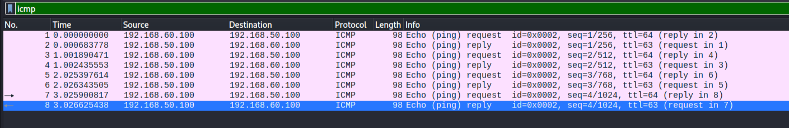

### 3.2 HTTP Traffic Analysis

Generated legitimate HTTP traffic to Ubuntu's Nginx service.

Observed the TCP connection and HTTP exchange in Wireshark.

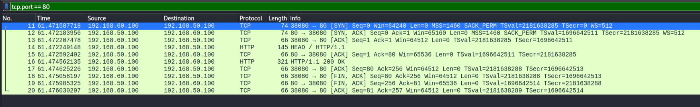

### 3.3 Firewall Log Verification

Reviewed pfSense logs to confirm that authorized traffic matched the configured Pass rules.

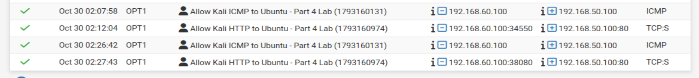

### 3.4 TCP Packet and Firewall Log Correlation

Compared TCP connection information between Wireshark and pfSense firewall logs.

Correlated:

- Source and destination addresses
- TCP source and destination ports
- SYN flags
- Firewall Pass action

This demonstrated how packet captures and firewall logs can be used together during a security investigation.

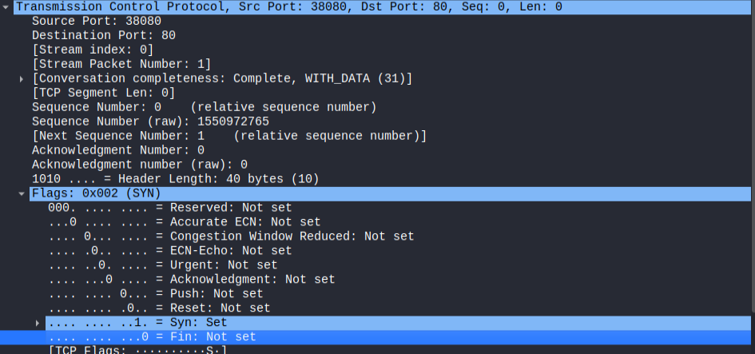

---

## 4. Phase 3 — Controlled Suspicious Traffic Investigation

Controlled connection attempts were generated to TCP ports 8080 and 8081.

These ports were not permitted by the OPT1 firewall policy.

### 4.1 Blocked TCP 8080 Connection

Executed:

    curl -v --connect-timeout 5 http://192.168.50.100:8080

The connection timed out.

Wireshark captured an initial TCP SYN packet followed by retransmissions.

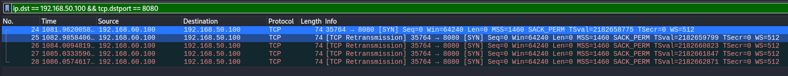

### 4.2 Default Deny Rule Verification

Reviewed pfSense firewall logs and confirmed that the TCP 8080 traffic was blocked by the default deny IPv4 rule.

Rule identifier:

    1000000103

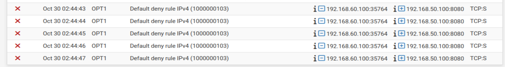

### 4.3 Additional TCP 8081 Test

Repeated the controlled connection test against TCP port 8081.

The connection timed out, and firewall logs showed the blocked TCP SYN packets.

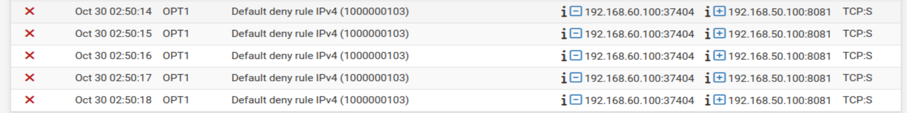

### 4.4 Distinguishing Connection Attempts from Packets

Initially, multiple blocked SYN packets appeared to indicate numerous connection attempts.

Further analysis showed that TCP retransmissions can generate several packet and firewall log entries from one connection attempt.

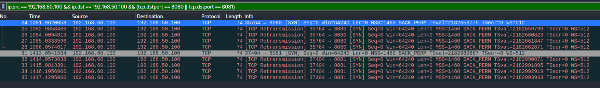

### 4.5 TCP Retransmission Analysis

Filtered Wireshark traffic using:

    ip.src == 192.168.60.100 &&
    tcp.srcport == 35764 &&
    ip.dst == 192.168.50.100 &&
    tcp.dstport == 8080

The original TCP 8080 test contained:

- One initial SYN packet
- Four SYN retransmissions
- Identical source and destination ports
- Identical raw TCP sequence numbers

This confirmed that five observed SYN packets represented one connection attempt and four retransmissions.

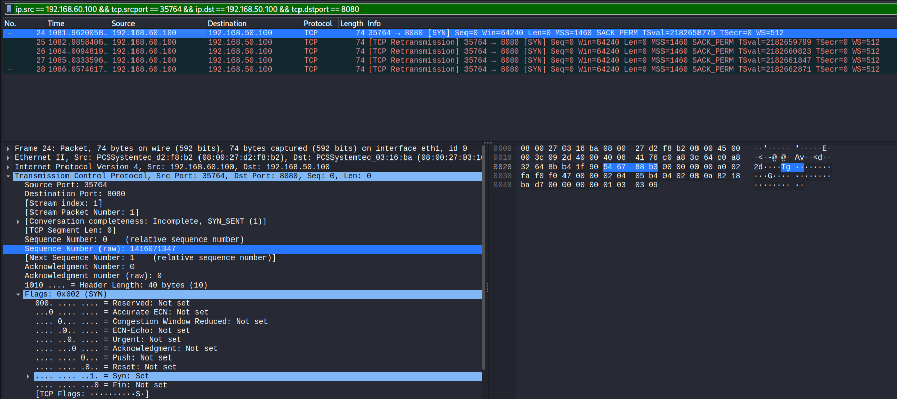

**Key Finding:** Multiple blocked packets do not necessarily represent multiple independent connection attempts.

---

## 5. Phase 4 — SOC Log Investigation

### 5.1 Firewall Log Correlation

Enabled raw firewall log viewing temporarily to examine additional details.

Confirmed:

- Source IP: 192.168.60.100
- Destination IP: 192.168.50.100
- Destination port: 8080
- Interface: OPT1 (em2)
- Firewall action: Block
- Rule: 1000000103

The log viewer's UTC timestamps were compared against the pfSense system time in America/Edmonton.

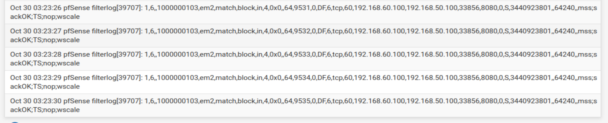

### 5.2 Activity Classification

**Classification:** Expected — Authorized Security Testing

The connection attempts were intentionally generated in the isolated homelab.

The evidence supported blocked TCP connection attempts and retransmissions, not a confirmed compromise.

---

## 6. Phase 5 — Defensive Response and Validation

### 6.1 Create an Explicit Firewall Block Rule

Created a temporary firewall rule with the following configuration:

| Setting | Value |
|---|---|
| Interface | OPT1 |
| Action | Block |
| Protocol | TCP |
| Source | 192.168.60.100 |
| Destination | 192.168.50.100 |
| Destination Port | 8080 |
| Logging | Enabled |

The rule was placed above the existing Pass rules.

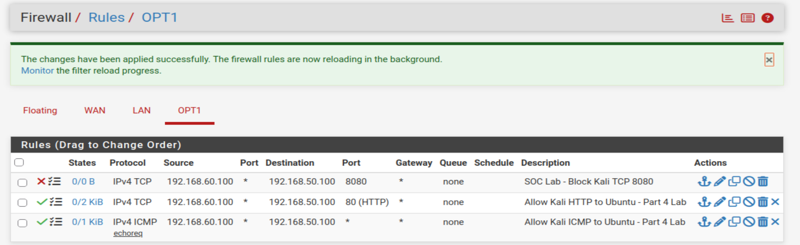

### 6.2 Validate the Custom Block Rule

Generated another TCP 8080 connection attempt.

The connection timed out.

pfSense logs confirmed that the temporary custom rule was responsible for blocking the traffic.

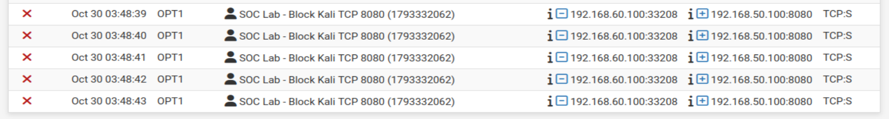

### 6.3 Verify Authorized HTTP Traffic

Tested the legitimate Nginx web service again:

    curl -I http://192.168.50.100

Result:

    HTTP/1.1 200 OK

This confirmed that the specific TCP 8080 Block rule did not disrupt authorized HTTP traffic on port 80.

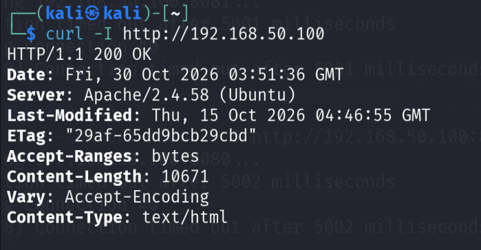

### 6.4 Restore Original Firewall Policy

Removed the temporary Block rule after validation.

Retested TCP 8080 and confirmed:

- The connection still timed out
- pfSense continued blocking the SYN packets
- The default deny IPv4 rule was responsible

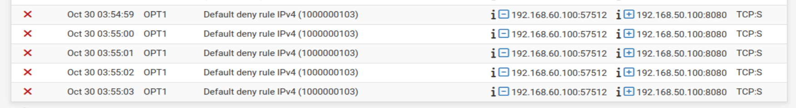

**Defensive Outcome:** The targeted rule was validated, legitimate traffic remained accessible, and the original firewall security policy was restored successfully.

---

## 7. Investigation Timeline

All timestamps below use UTC. Verified earlier events are included here; the remaining defensive actions are presented in their tested sequence above.

| Date and Time (UTC) | Event | Finding |
|---|---|---|
| Oct 30, 2026, 02:27:43 | Normal HTTP traffic | TCP 80 permitted |
| Oct 30, 2026, 02:44:43–47 | TCP 8080 test | SYN packets blocked |
| Oct 30, 2026, 02:50:14–18 | TCP 8081 test | SYN packets blocked |
| Oct 30, 2026, 03:23:26–30 | TCP 8080 retest | Raw logs confirmed default deny |

---

## 8. Final SOC Findings

1. Authorized ICMP and HTTP traffic was successfully permitted through pfSense.
2. Unauthorized-by-policy TCP connection attempts to ports 8080 and 8081 were blocked.
3. Wireshark analysis distinguished TCP retransmissions from independent connection attempts.
4. Firewall logs and packet captures provided complementary investigation evidence.
5. A narrowly scoped Block rule was successfully tested without disrupting HTTP traffic.
6. Removing the temporary rule restored the original configuration while retaining default deny protection.

### Security Assessment

No successful TCP connection to the tested blocked ports was observed.

The evidence does not establish malicious intent or a successful intrusion.

This project represents a controlled, authorized security investigation rather than an actual security incident.

---

## 9. Lessons Learned

- Multiple firewall log entries can represent retransmissions from one connection attempt.
- TCP flags, source ports, sequence numbers, and timestamps are important for packet analysis.
- Firewall rule order and specificity affect network access decisions.
- Wireshark and firewall logs help validate each other's findings.
- Network connectivity and firewall behavior should be tested independently.
- Security controls should be validated before and after configuration changes.
- Careful documentation is essential for an effective SOC investigation.

---

## 10. Investigation Report and Evidence

### Full Investigation Report

[View SOC Investigation Report](investigation-report.md)

### Wireshark Packet Capture

[Download TCP 8080 SYN Retransmission Capture](captures/tcp8080-syn-retransmissions.pcapng)

### Evidence Screenshots

All 20 screenshots are documented in their corresponding investigation sections above and stored in the `screenshots/` directory.

---

## 11. Conclusion

This project provided hands-on experience with a SOC-style network investigation using pfSense and Wireshark.

The investigation included baseline traffic verification, controlled connection testing, packet analysis, firewall log correlation, defensive control validation, and restoration of the original firewall policy.

The focus was not simply on generating blocked traffic, but on understanding why the connections failed, identifying the responsible firewall rules, and documenting findings supported by network evidence.

**Environment:** Isolated VirtualBox homelab

**Purpose:** Cybersecurity learning, network threat analysis, and SOC portfolio development
